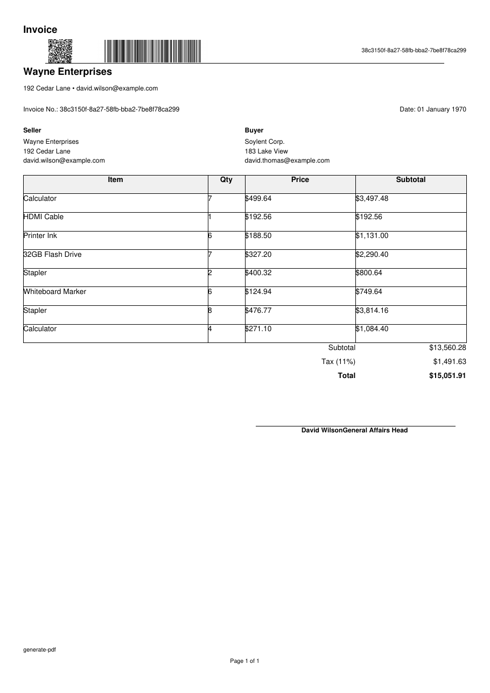

# generate-pdf (pdfgen)

[English README](README.md)

`pdfgen` adalah CLI dan library Go kecil untuk membuat file PDF **contoh (dummy)**
dalam enam jenis dokumen kantor: invoice, surat resmi, laporan, kuitansi, surat jalan,
dan sertifikat.

Keluaran default berbahasa Inggris; pakai `--lang id` untuk bahasa Indonesia. Slug
jenis dokumen dan nama file tetap bahasa Inggris di kedua bahasa.

Semua isinya data karangan, bukan data asli, jadi aman dipakai untuk demo, latihan,
tampilan ke klien, atau menguji aplikasi lain yang membutuhkan contoh PDF. File bisa
dibuka di pembaca PDF biasa dan lolos pemeriksaan `pdfcpu`.

Dengan `seed` yang sama, isi PDF selalu sama, sehingga hasilnya bisa diulang untuk
pengujian. Nama file tetap berbeda tiap kali generate supaya tidak saling menimpa.

## Status

Tahap awal (`v0.2.x`). CLI dan format manifest dapat berubah pada rilis minor; pin
versi rilis bila membutuhkan antarmuka yang stabil. Project dikelola oleh satu orang
dengan dukungan best-effort, dan hanya rilis terbaru yang menerima perbaikan.

Pesan CLI, error, dan deskripsi flag memakai bahasa Inggris. Keluaran saat berjalan
dan isi PDF mengikuti `--lang`; dokumentasi tersedia dalam bahasa Inggris dan
Indonesia.

## Versi dan kompatibilitas

Rilis memakai Semantic Versioning. Selama versi masih di bawah `1.0`, rilis minor
dapat memuat perubahan yang tidak kompatibel pada CLI atau manifest; rilis patch
berisi perbaikan. Hanya rilis terbaru yang didukung, sesuai [SECURITY.md](SECURITY.md).

## Persyaratan dan instalasi

- Go 1.26.10 atau lebih baru bila membangun dari source.
- Binary rilis tersedia untuk Linux, macOS, dan Windows pada `amd64` dan `arm64`;
  tidak membutuhkan runtime tambahan.
- Folder output harus dapat ditulis. Aplikasi tidak melakukan akses jaringan.

Unduh arsip sesuai OS dari [Releases](https://github.com/ardizariat/generate-pdf/releases),
atau instal dengan Go:

```bash
go install github.com/ardizariat/generate-pdf/cmd/pdfgen@latest
```

Dari hasil clone:

```bash
make build    # menghasilkan ./pdfgen
```

Cek versi:

```bash
pdfgen --version
```

Setiap rilis juga menyertakan `checksums.txt`. Untuk memverifikasi arsip unduhan:

```bash
sha256sum -c checksums.txt --ignore-missing   # Linux
shasum -a 256 -c checksums.txt                # macOS
```



## Cara pakai

Pilih cara yang sesuai kebutuhan:

| Kebutuhan | Cara |
|---|---|
| Coba-coba dan ingin dituntun form | jalankan `pdfgen` di terminal |
| Satu PDF dengan pengaturan tertentu | `pdfgen --no-input` + flag |
| Banyak PDF sekaligus dengan daftar pengaturan | `pdfgen --batch jobs.yaml` |

### Interaktif

Jalankan di terminal tanpa `--no-input`:

```bash
pdfgen
```

Satu form menanyakan **jumlah file**, **jenis dokumen** (boleh lebih dari satu), dan
**satu jumlah halaman** yang dipakai untuk semua file. Setelah form selesai generate
langsung berjalan dan ringkasan dicetak ke stdout.

### Satu dokumen (noninteraktif)

```bash
pdfgen --no-input                                  # invoice default
pdfgen -t report --lang id -s 7 --no-input --verify
pdfgen -t certificate --lang id --title "Sertifikat Pelatihan" --no-input
pdfgen -t receipt --out output/receipt.pdf
pdfgen -t report --lang id --out-dir hasil --no-input   # tulis ke hasil/
```

Pada mode ini `--rows` mengatur jumlah baris tabel; tidak ada opsi jumlah halaman pasti.

### Batch

```bash
pdfgen --batch jobs.yaml --no-input
```

Manifest dan aturan halaman dijelaskan di [Batch dan target halaman](#batch-dan-target-halaman).

### Perintah lain

```bash
pdfgen types    # tampilkan jenis dokumen yang didukung
```

Bila stdin bukan terminal (mis. pipe/CI), `pdfgen` otomatis memakai mode satu dokumen
noninteraktif. Nama file default selalu
`<out-dir>/<type>_<timestamp UTC>_<uuid v7>.pdf`, dan folder output dibuat otomatis.
Menimpa file yang sudah ada hanya dengan `--force`.

## Library

Modul root menyediakan API Go tipis di atas renderer yang sama:

```go
import "github.com/ardizariat/generate-pdf"

res, err := pdfgen.Generate("out/report.pdf", pdfgen.Options{
	Type:     "report",
	Language: "id",       // "" = en
	Rows:     40,         // -1 = default per jenis
	Seed:     7,
})
if err != nil {
	return err
}
fmt.Println(res.Pages, res.Bytes)
```

`Render(w io.Writer, opts Options)` menulis ke writer apa pun, bukan ke file. Default
`Options`: `Type` kosong berarti `invoice`, `Language` kosong berarti `en`, `Title`
kosong berarti judul jenis sesuai bahasa, dan `Rows: -1` memakai default per jenis.
`Seed: 0` tetap deterministik (berbeda dari CLI, yang mengartikan `0` sebagai acak).
`Generate` menolak menimpa file yang sudah ada kecuali `Force` diisi. Error dapat
dicocokkan dengan `errors.Is(err, pdfgen.ErrInvalidOptions)`,
`ErrUnsupportedType`, atau `ErrOutputExists`.

Package internal tetap `internal/`; permukaan publik hanya `Options`, `Result`,
`Render`, `Generate`, dan sentinel error. Belum ada API context atau batch.

## Jenis dokumen

| `--type` | Default `--rows` | Default `--title` | Isi |
|---|---|---|---|
| `invoice` | 8 | Invoice | Kop, penjual/pembeli, tabel barang, subtotal/PPN 11%/total, tanda tangan |
| `letter` | 0 (tanpa tabel) | Letter / Surat Resmi | Kop, nomor, perihal, tujuan, tiga paragraf, tanda tangan |
| `report` | 70 | Report / Laporan | Dua paragraf dan tabel yang mengalir multi-halaman |
| `receipt` | 0 (tanpa tabel) | Receipt / Kuitansi | Kotak berbingkai, nominal angka dan terbilang, tanda tangan |
| `delivery-note` | 25 | Delivery Note / Surat Jalan | Tujuan, tabel barang, tanda tangan pengirim dan penerima |
| `certificate` | 0 (tanpa tabel) | Certificate / Sertifikat | Landscape, nama besar, paragraf penghargaan, QR verifikasi |

`--rows` hanya berpengaruh pada `invoice`, `report`, dan `delivery-note`; untuk jenis
lain nilainya diabaikan.

## Bahasa

`--lang` (atau `GENPDF_LANG`, atau key `lang` di file konfigurasi) memilih bahasa:

| Nilai | Data | Uang | Tanggal | Nominal dalam kata |
|---|---|---|---|---|
| `en` (default) | Nama dan alamat internasional ASCII | `$1,234.56` | `02 January 2006` | `one thousand two hundred thirty-four dollars` |
| `id` | Nama dan alamat Indonesia | `Rp1.234.567` | `02 Januari 2006` | `satu juta dua ratus tiga puluh empat ribu rupiah` |

Bahasa tidak pernah dideteksi dari `LANG`; default selalu `en`. Nilai yang tidak
dikenal dianggap error konfigurasi. Slug jenis dokumen, nama file, teks bantuan, dan
error tetap bahasa Inggris.

## Batasan yang diketahui

- Hanya tersedia dua bahasa: Inggris dan Indonesia. Tidak ada deteksi otomatis atau
  terjemahan kustom.
- `letter`, `receipt`, dan `certificate` selalu 1 halaman. Target halaman pasti hanya
  tersedia untuk dokumen bertabel, dan hanya di mode batch.
- Layout bersifat tetap. Tidak ada template, logo, font kustom, enkripsi PDF, atau
  tanda tangan digital.
- Pencarian target halaman dibatasi 2000 baris tabel; target yang lebih besar akan
  gagal, bukan berjalan tanpa henti.
- Mode interaktif mengabaikan `--rows` dan `--out`.
- Kolom manifest yang tidak dikenal ditolak; key file konfigurasi yang tidak dikenal
  diabaikan.
- Nama file memuat timestamp dan UUID sehingga tidak deterministik. Gunakan `--out`
  atau `out` di manifest bila membutuhkan path yang dapat diprediksi.
- Tidak tersedia binary 32-bit.

## Flag

| Flag | Default | Keterangan |
|---|---|---|
| `-t, --type` | `invoice` | Jenis dokumen: `invoice`, `letter`, `report`, `receipt`, `delivery-note`, `certificate` |
| `--lang` | `en` | Bahasa keluaran: `en` atau `id` |
| `-o, --out` | `<out-dir>/<type>_<UTC>_<uuid v7>.pdf` | Path output PDF (persis) |
| `--out-dir` | `output` | Folder dasar output default dan path relatif; dibuat otomatis |
| `-r, --rows` | `-1` (efektif per jenis) | Jumlah baris tabel mode satu dokumen; diabaikan bila jenis tidak bertabel |
| `-s, --seed` | `42` | Seed data (`uint64`); `0` berarti acak |
| `--title` | per jenis | Judul dokumen |
| `--batch` | kosong | Path manifest YAML berisi daftar job; bila diisi, mode batch dan prompt dilewati |
| `--no-input` | `false` | Matikan prompt interaktif |
| `--force` | `false` | Izinkan menimpa file output yang sudah ada |
| `--verify` | `false` | Validasi PDF dengan pdfcpu sebelum file final ditulis |
| `-v, --verbose` | `false` | Log level `info` (default `warn`) |
| `--config` | kosong | Path file konfigurasi eksplisit |
| `--version` | | Tampilkan versi |

Exit code: `0` sukses, `1` untuk kegagalan apa pun (config tidak valid, file tujuan
sudah ada, prompt dibatalkan, render/verifikasi gagal).

## Konfigurasi

Urutan prioritas (tertinggi ke terendah):

1. Flag CLI
2. Environment variable `GENPDF_*`
3. File konfigurasi
4. Default (umum dan per jenis)

Sumber file, berurutan sesuai prioritas:

- `--config <path>` untuk file eksplisit, atau
- environment variable `GENPDF_CONFIG=<path>`, atau
- `generate-pdf.yaml` di direktori kerja saat ini.

File konfigurasi bersifat opsional; bila tidak ada, bukan error. Aplikasi tidak pernah
menulis file konfigurasi. Nama key sama dengan nama flag:

```yaml
# generate-pdf.yaml
type: report
lang: id
rows: 20
seed: 7
out-dir: hasil
verify: true
```

Environment variable memakai prefix `GENPDF_` dengan `-` diganti `_`:
`GENPDF_TYPE`, `GENPDF_LANG`, `GENPDF_OUT`, `GENPDF_OUT_DIR`, `GENPDF_ROWS`, `GENPDF_SEED`,
`GENPDF_TITLE`, `GENPDF_BATCH`, `GENPDF_NO_INPUT`, `GENPDF_FORCE`, `GENPDF_VERIFY`,
`GENPDF_VERBOSE`, `GENPDF_CONFIG`.

Config divalidasi setelah semua sumber digabung dan sekali lagi setelah prompt:
`type` wajib salah satu jenis di atas, `lang` harus `en` atau `id`, dan `rows`
minimal `0`. Bila `--out` tidak
diberikan, path dihitung dari `--out-dir` dan nama file otomatis.

## Mode interaktif dan noninteraktif

- **Interaktif** aktif bila stdin adalah terminal dan `--no-input` tidak diberikan.
  Satu form saja: jumlah file, jenis dokumen (multi-select, boleh lebih dari satu), dan
  satu jumlah halaman yang dipakai untuk semua file. Jenis dipakai berurutan secara
  berputar bila file lebih banyak daripada jenis.
  - Bila `--type`/env/file sudah menentukan jenis, field multi-select dilewati dan
    semua file memakai jenis itu.
  - `--rows` dan `--out` tidak dipakai di mode ini; lokasi diatur `--out-dir` dan nama
    file selalu otomatis.
  - Jumlah halaman > 1 hanya berlaku untuk `invoice`, `report`, dan `delivery-note`;
    jenis tanpa tabel selalu 1 halaman.
  - Path output, seed, dan judul tidak ditanyakan: output otomatis
    `<out-dir>/<type>_<UTC>_<uuid v7>.pdf`, seed dari flag/env/default, judul default
    per jenis atau `--title`.
  - Tidak ada konfirmasi; generate langsung berjalan dan ringkasan dicetak setelahnya.
    Membatalkan form menghasilkan error `input dibatalkan` dan exit code `1`.
- **Noninteraktif** berlaku bila `--no-input` diberikan, stdin bukan terminal, atau
  `--batch` digunakan. Semua nilai diambil dari flag, env, file konfigurasi, atau
  default; tidak ada pertanyaan dan tidak ada pembacaan stdin.

## Batch dan target halaman

Bagian ini dipakai untuk membuat **banyak PDF sekaligus** tanpa menjawab form satu per
satu. Cocok saat Anda butuh puluhan atau ratusan file contoh untuk menguji aplikasi,
mengisi folder demo, atau menyiapkan bahan presentasi.

Caranya: tulis "daftar pesanan" PDF di satu file YAML bernama `jobs.yaml` (disebut
**manifest**), lalu jalankan satu perintah. Setiap entri di daftar itu menjadi satu file
PDF.

Contoh: Anda ingin tiga PDF — invoice 2 halaman, laporan 3 halaman, dan surat jalan
1 halaman.

```yaml
jobs:
  - type: invoice       # jenis dokumen
    pages: 2            # PDF ini harus tepat 2 halaman
    seed: 7             # penentu isi; seed sama = isi sama
    out: invoice-a.pdf  # nama file; relatif -> <out-dir>/invoice-a.pdf
  - type: report
    pages: 3
    seed: 8             # out tidak ditulis -> nama unik otomatis
  - type: delivery-note # jenis tanpa tabel, wajib 1 halaman
```

Jalankan dengan:

```bash
pdfgen --batch jobs.yaml --no-input
```

### Arti tiap kolom

| Kolom | Arti sederhana |
|---|---|
| `type` | Jenis dokumen yang dibuat. Boleh juga diisi lewat `--type` sebagai default. |
| `pages` | Jumlah halaman yang **harus** dihasilkan. Default 1. |
| `seed` | Angka penentu isi. Seed sama menghasilkan isi yang sama; `0` berarti acak. |
| `out` | Nama/lokasi file. Kosong berarti nama unik otomatis. |
| `title` | Judul dokumen. Kosong berarti `--title` (bila diberikan) atau judul default sesuai jenis. |

### Yang perlu diketahui

- **`pages` harus tepat.** Untuk dokumen bertabel, program mengisi baris tabel
  sebanyak mungkin sampai pas dengan jumlah halaman itu, lalu menghitung halaman
  dengan `pdfcpu`. Kalau target tidak bisa dicapai, file itu gagal dibuat.
- **Halaman lebih dari 1 hanya untuk dokumen bertabel**: `invoice`, `report`, dan
  `delivery-note`. `letter`, `receipt`, dan `certificate` selalu 1 halaman.
- **`--rows` tidak dipakai di mode batch.** Jumlah isi tabel diatur oleh `pages`.
- **Semua entri diperiksa dulu sebelum menulis file.** Satu entri salah membuat seluruh
  batch berhenti tanpa menghasilkan file apa pun.
- **Satu file gagal tidak menghentikan sisanya.** Program lanjut ke entri berikutnya,
  lalu mencetak ringkasan dan exit code `1` bila ada yang gagal.
- **`type`, `seed`, dan `title` yang kosong mewarisi pengaturan global** dari
  flag/env/file konfigurasi. `out` kosong menjadi
  `<out-dir>/<type>_<timestamp UTC>_<uuid v7>.pdf`; `out` relatif diselesaikan terhadap
  `--out-dir`, sedangkan path absolut dipakai apa adanya.
- **`--force`, `--verify`, dan `-v` berlaku untuk semua entri.** Tanpa `--force`, file
  yang sudah ada tidak ditimpa.
- **Kolom yang tidak dikenal ditolak** dengan error sebelum file apa pun ditulis,
  sehingga typo seperti `page:` alih-alih `pages:` langsung ketahuan. Batch tidak
  pernah menampilkan form.

### Cara membaca hasilnya

Selama proses berjalan, progress muncul di stderr (spinner `[2/3] nama-file.pdf ·
target 2 halaman`, atau satu baris teks bila bukan terminal). Setelah selesai, stdout
berisi ringkasan per file, misalnya:

```
ok     output/report_20261021T141530Z_0192f3a4-....pdf  3 pages  178697 bytes
summary: 3 succeeded, 0 failed
```

## Perilaku output

- Nama default `<out-dir>/<type>_<timestamp UTC>_<uuid v7>.pdf`, mis.
  `output/invoice_20261021T141530Z_0192f3a4-....pdf`. `--out-dir` default `output`.
  Timestamp memakai `YYYYMMDDTHHMMSSZ`; UUID v7 dibuat per file.
- `--out` menang atas `--out-dir` untuk nama file; isinya dipakai persis, termasuk
  path absolut.
- Folder output dibuat otomatis (`MkdirAll`), termasuk folder induk dari `--out` atau
  `out` relatif di manifest. Error hanya bila path ada tapi bukan direktori atau gagal
  dibuat.
- Bila file tujuan sudah ada, generate **ditolak** dengan error yang menyebut path dan
  cara mengizinkannya. `--force` mengizinkan penimpaan. Pada batch, hanya job itu yang
  gagal dan job lain tetap berjalan.
- `--verify` memvalidasi hasil sementara dengan pdfcpu sebelum menggantikan file
  tujuan; verifikasi gagal berarti generate gagal. Jumlah halaman selalu dihitung
  (lewat pdfcpu) sebagai bagian dari proses generate, terlepas dari `--verify`.
- Setiap PDF ditulis ke file sementara di folder tujuan lalu di-rename hanya setelah
  render (dan verifikasi bila `--verify` dipakai) berhasil. Kegagalan tidak
  meninggalkan file parsial dan tidak mengganti file lama.
- Generate baru dinyatakan berhasil setelah file selesai ditulis.

## Determinisme

- Seed, jenis, jumlah baris, dan judul yang sama menghasilkan PDF dengan isi dan
  metadata identik. Nama file **tidak** deterministik karena memakai timestamp dan
  UUID v7; pakai `--out`/`out` untuk path yang dapat diprediksi.
- Tanggal dokumen diturunkan dari seed (`time.Unix(seed, 0).UTC()`) dan ID dokumen
  adalah UUID v5 dari `<type>-<seed>`. Pada batch, setiap job memakai seed-nya sendiri.
- `--seed 0` berarti data acak; output tidak deterministik.
- Default seed adalah `42`, sehingga pemakaian tanpa flag tetap dapat direproduksi.

## Contoh hasil

Contoh PDF dengan seed tetap:

| Dokumen | File |
|---|---|
| Invoice | [examples/invoice.pdf](examples/invoice.pdf) |
| Surat resmi | [examples/letter.pdf](examples/letter.pdf) |
| Laporan | [examples/report.pdf](examples/report.pdf) |
| Kuitansi | [examples/receipt.pdf](examples/receipt.pdf) |
| Surat jalan | [examples/delivery-note.pdf](examples/delivery-note.pdf) |
| Sertifikat | [examples/certificate.pdf](examples/certificate.pdf) |

## Dependensi

Modul runtime (dependency langsung; dependency tidak langsung tercatat di `go.mod`
dan `go.sum`, yang menjadi inventaris resmi):

| Modul | Fungsi |
|---|---|
| `spf13/cobra` | command dan flag CLI |
| `spf13/viper` | file konfigurasi dan environment variable |
| `charm.land/huh/v2` | form interaktif |
| `charm.land/lipgloss/v2` | styling terminal |
| `go.uber.org/zap` | structured logging |
| `johnfercher/maroto/v2` | layout PDF |
| `phpdave11/gofpdf` | katalog dan metadata PDF deterministik |
| `pdfcpu/pdfcpu` | validasi PDF dan penghitungan halaman |
| `boombuler/barcode` | pembuatan barcode dan QR |
| `brianvoe/gofakeit/v7` | nama dan alamat fiktif |
| `google/uuid` | ID dokumen dan nama file unik |
| `shopspring/decimal` | aritmetika uang |
| `go-playground/validator/v10` | validasi konfigurasi |
| `go.yaml.in/yaml/v3` | parsing manifest batch |

Peralatan development dan rilis:

- Go 1.26.10+ dan `golangci-lint` v2 untuk pemeriksaan lokal.
- `testify` untuk test (hanya dependency test).
- [goreleaser](https://goreleaser.com/) v2 untuk arsip rilis (hanya workflow rilis).
- `govulncheck` melalui `go run` untuk `make vuln` dan CI.

## Menjalankan test

```bash
make build   # go build ./...
make test    # go test ./... -count=1
make fmt     # gofmt -w .
make lint    # golangci-lint run (govet, errcheck, staticcheck, gofmt, unused)
make race    # go test -race ./... -count=1
make vuln    # govulncheck ./...
make run     # go run ./cmd/pdfgen
```

`make lint` membutuhkan `golangci-lint` v2 terpasang. Bila belum tersedia, jalankan
pemeriksaan setara secara manual:

```bash
go vet ./...
gofmt -l .
```

CI menjalankan test di Linux, macOS, dan Windows; race detector, lint, dan pemeriksaan
kerentanan hanya di Linux.

## Melaporkan bug dan meminta fitur

- **Bug:** buka issue di
  <https://github.com/ardizariat/generate-pdf/issues/new/choose> dan sertakan perintah
  yang dijalankan, hasil yang diharapkan dan yang terjadi, serta versi OS/Go.
- **Permintaan fitur:** gunakan halaman issue yang sama dan jelaskan kebutuhan serta
  workaround yang sedang dipakai.
- **Masalah keamanan:** jangan buka issue publik; ikuti [SECURITY.md](SECURITY.md).

## Kontribusi dan keamanan

Baca [CONTRIBUTING.md](CONTRIBUTING.md) sebelum membuka pull request. Dengan
berpartisipasi, Anda setuju mengikuti [Code of Conduct](CODE_OF_CONDUCT.md).
Laporkan masalah keamanan secara privat sesuai [SECURITY.md](SECURITY.md).

## Lisensi

[MIT](LICENSE) © 2026 Ardi Dzariat
